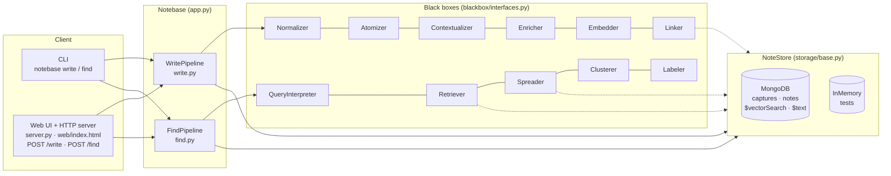
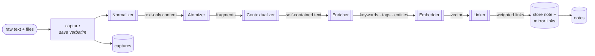
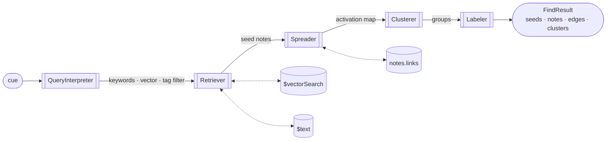

# Architecture

Notebase has two verbs, `write` and `find`. Each one is a fixed pipeline of
**black boxes**: an interface whose implementation can be swapped without
touching anything else. Right now every box has a placeholder stub
(`notebase/blackbox/stubs.py`), so the whole system runs end to end on MongoDB.
Boxes get replaced by real implementations one at a time. So far the
**Embedder** (`notebase/blackbox/embedders.py`, see [embedding.md](embedding.md))
and the **Normalizer** (images only), **Atomizer** and **Enricher**
(`notebase/blackbox/llm.py`, see [llm.md](llm.md)) are real.

## Layers



* **Pipelines** only orchestrate. They contain no algorithmic decisions.
* **Black boxes** hold all the algorithmic decisions. Each is a `Protocol`.
* **Clients** are thin. The CLI builds the app on every call; `notebase-web`
  (`server.py`) builds it once and serves the same two verbs over HTTP, plus a
  single-file web UI (`web/index.html`, no build step, no CDN) that draws a find
  result as a graph: seeds ringed in the middle, node size from `activation`,
  clusters as labelled halos, click a note to re-centre (a new find from it).
* **NoteStore** is the only way to persist or query data. MongoDB is the
  real backend, and an in-memory store with the same contract is used for tests.

## Write



| Black box | Contract | Current stub | Intended real version |
|---|---|---|---|
| Normalizer | `Capture -> str` (text + attachments → text) | ✅ **images real**: Claude (Haiku 5.5) alt text describing the content and quoting important text, one call per image, typed text as context. Other files, and any image that fails, get the stub's file-name marker: `whiteboard_plan.jpg` → `[image: whiteboard plan (whiteboard_plan.jpg)]`. Markers go on their own lines after the typed text | audio transcripts (local speech-to-text), PDF and web-page text extraction |
| Atomizer | `Capture.content -> list[str]` | ✅ **real**: Claude (Haiku 5.5) splits into self-contained notes; paragraph split as fallback | n/a |
| Contextualizer | `(fragment, Capture) -> str` | identity (the LLM Atomizer already resolves references) | separate pass only if atomizing and contextualizing need different models |
| Enricher | `list[str] -> list[Enrichment]` (one call per capture) | ✅ **real**: Claude (Haiku 5.5) keywords with synonyms and zh/en equivalents, tags reused from the store's vocabulary, entities; frequency stub as fallback | n/a |
| Embedder | `embed_documents(list[str])`, `embed_query(str)` | ✅ **real**: Qwen3-Embedding-0.6B (local); hashing stub kept for tests | n/a |
| Linker | `(Note, store, siblings) -> list[Link]` | top-k calibrated similarity above a threshold | similarity + shared entities + temporal proximity, LLM-judged relations |

## Find



| Black box | Contract | Current stub | Intended real version |
|---|---|---|---|
| QueryInterpreter | `str -> Query` | tokenize + embed; `#tag` becomes a filter | LLM query expansion, time and entity filters ("last summer", "from Alice") |
| Retriever | `(Query, store, k) -> list[ScoredNote]` | reciprocal-rank fusion of vector and keyword hits | tuned hybrid search, reranker |
| Spreader | `(seeds, store) -> {id: activation}` | BFS, `activation × weight × decay` per hop | spreading activation with recency and frequency weighting |
| Clusterer | `notes -> list[list[id]]` | connected components over strong links | community detection (Louvain/Leiden) or embedding clustering |
| Labeler | `list[Note] -> str` | most common tags | LLM summary label |

`FindResult` is everything a graph view needs to render the zoomed-in region:
`seeds` (highlighted centre), `notes` (nodes), `activation` (node size or
distance), `edges` (only those inside the region) and `clusters` (groups and
their labels).

## MongoDB data model

**`captures`**: raw input, never modified.

```jsonc
{
  "_id": "c_…",
  "text": "…",                   // what the user typed, verbatim
  "source": "typed",
  "attachments": [               // references to attached files, not their bytes
    { "id": "a_…", "name": "board.jpg", "media_type": "image/jpeg",
      "path": "/Users/…/board.jpg", "size": 482113, "sha256": "…" }
  ],
  "normalized": "…",             // the Normalizer's text-only version, what the boxes read
  "created_at": ISODate
}
```

The capture is saved before the Normalizer runs and saved again with
`normalized` filled in, so the typed text and file references are never lost.
Only a **reference** to each file is stored (path, size, SHA-256). If the file
is moved or deleted, the note keeps its alt text but the original is gone.
Copying the bytes into the store (e.g. GridFS) is left for when a real
Normalizer needs to re-read them. Files uploaded through the web UI are the
exception that already has a copy: the server keeps them under
`NOTEBASE_FILES_DIR/<sha256>/<file name>` and the capture points there.

**`notes`**: one document per atomic note. The vector and the graph edges live
on the note itself.

```jsonc
{
  "_id": "n_…",
  "content": "…",
  "capture_id": "c_…",
  "source": "typed",
  "keywords": ["…"],
  "tags": ["…"],
  "entities": [{ "type": "url", "name": "…" }],
  "embedding": [0.01, …],                         // vector
  "links": [{ "to": "n_…", "weight": 0.62, "reason": "semantic" }],  // edges
  "created_at": ISODate
}
```

| Index | Type | Used by |
|---|---|---|
| `note_embedding` on `embedding` (cosine) + filter `tags` | Vector Search | `vector_search` → Linker, Retriever |
| `note_text` on `content`, `keywords` | text | `keyword_search` → Retriever |
| `links.to` | B-tree | reverse link lookups |
| `capture_id` | B-tree | provenance |

Links are **mirrored**: when A links to B, B also gets a link to A, because
association runs both ways. Edges are stored as an embedded array, so one
`find({_id: {$in: frontier}})` per hop is enough to spread. If the graph gets
large, the edges can move to their own collection and use `$graphLookup`
without changing the `NoteStore` contract.

### Caveats

* `$vectorSearch` needs Atlas, the `mongodb/mongodb-atlas-local` image (see
  `docker-compose.yml`) or Community 8.2+ with `mongot`.
* The vector index is **eventually consistent**: a note becomes searchable
  shortly after it is written. Notes from the *same* capture are handed to the
  Linker as `siblings` so they always link to each other. Notes written by
  separate captures less than about a second apart may miss each other.
* Atlas reports cosine scores as `(1 + cos) / 2`. `MongoNoteStore` converts
  them back, so the store contract always returns raw cosine.
* MongoDB's `$text` index does not segment Chinese. The stub enricher stores
  CJK bigrams in `keywords` as a workaround. A real setup would use Atlas
  Search with a CJK analyzer.
